# SuperDuperDrive

**A quantum-ready personal cloud drive: hybrid ML-KEM + X25519 envelope encryption, ML-DSA
signatures, Argon2id — built with Spring Boot 3 and Bouncy Castle.**

[](https://github.com/xlsarath/superduperdrive/actions/workflows/ci.yml)


[](LICENSE)

Store files, notes and website credentials. Everything you put in is sealed under its own key,
encapsulated to your personal hybrid post-quantum key pair, and every file is signed with
ML-DSA-65. A stolen database or blob store reveals none of your content, today or after
large quantum computers arrive.

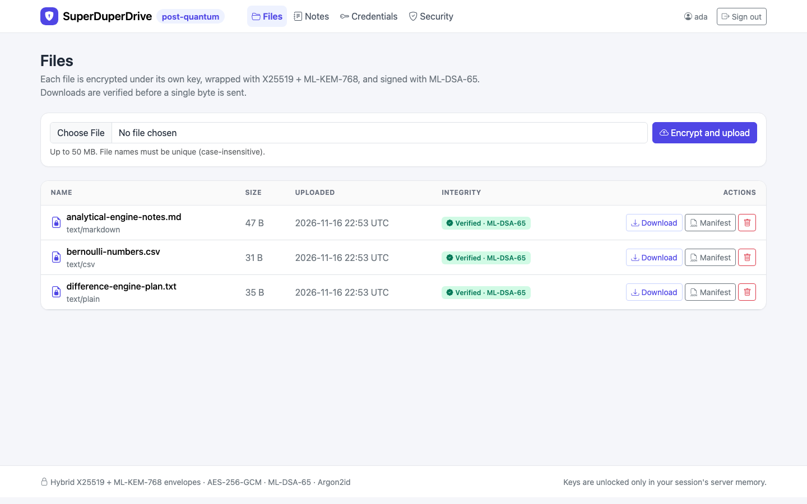

## Highlights

- **Hybrid KEM envelopes.** Each item gets a fresh AES-256-GCM data key, wrapped by a key derived
  from X25519 **and** ML-KEM-768 (FIPS 203) through an X-Wing-style HKDF-SHA-512 combiner. The
  data stays safe while either algorithm holds.
- **Streaming file encryption.** STREAM segmented AEAD with 64 KiB segments: constant memory,
  and resistance to truncation and reordering.
- **ML-DSA-65 signatures.** Each upload is signed as a canonical JSON manifest (FIPS 204, with
  a context string). Downloads are verified before the first byte leaves the server, and the
  signed manifest can be exported.
- **Keys only you can unlock.** Private keys are wrapped with Argon2id(password) and with a
  one-time recovery key, held unlocked only in session memory, and wiped on sign-out.
- **Crypto agility.** Suite ids and versions on every row, a suite registry, automatic
  migration on login, and per-item re-keying from the Security page. Accounts stored in the
  2020 formats (PBKDF2-SHA1 hashes, AES/ECB credentials) are upgraded the first time they sign
  in.
- **Post-quantum TLS (optional).** The `pqtls` profile serves TLS 1.3 through Bouncy Castle JSSE
  with the `X25519MLKEM768` key exchange.

## Screenshots

| | |
|---|---|
| 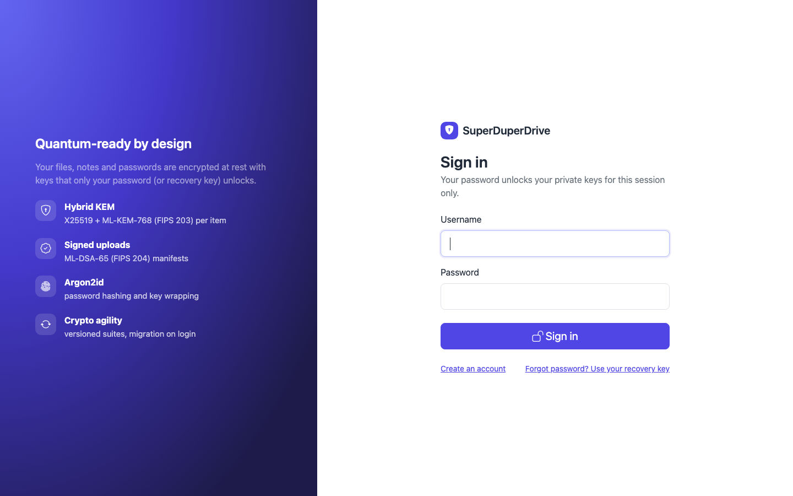 | 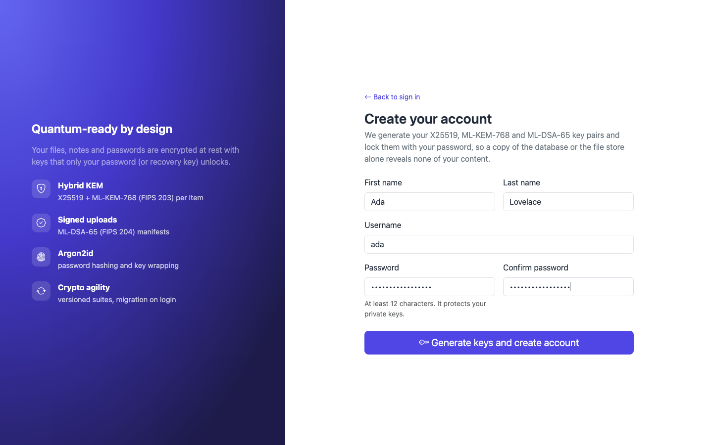 |
| **Sign in.** Argon2id, lockout and rate limiting | **Sign up.** Key pairs are generated here |
| 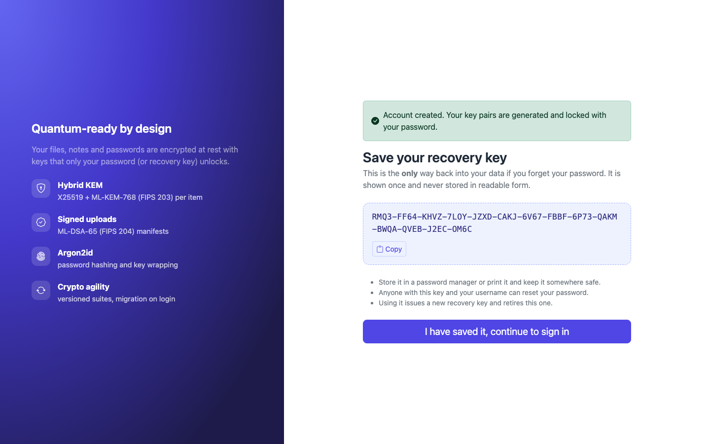 |  |
| **Recovery key.** Shown exactly once | **Files.** Encrypted, signed, verified |
| 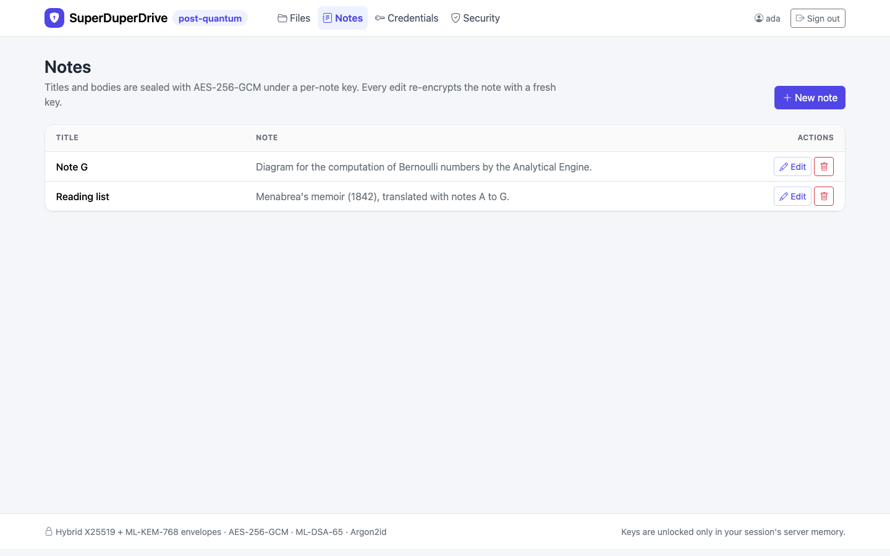 | 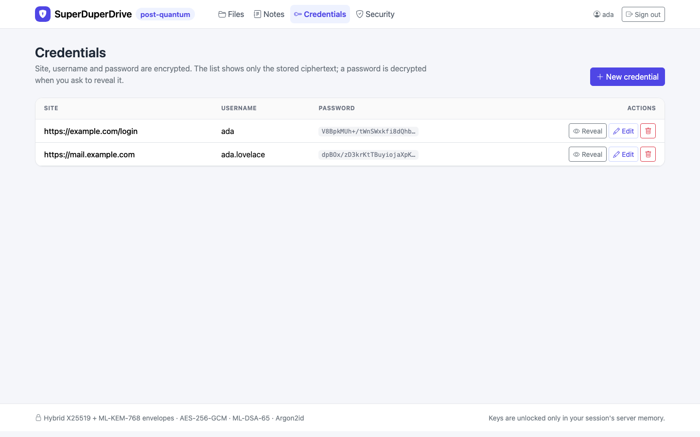 |
| **Notes.** Re-encrypted under a fresh key on every edit | **Credentials.** Only ciphertext is listed |
| 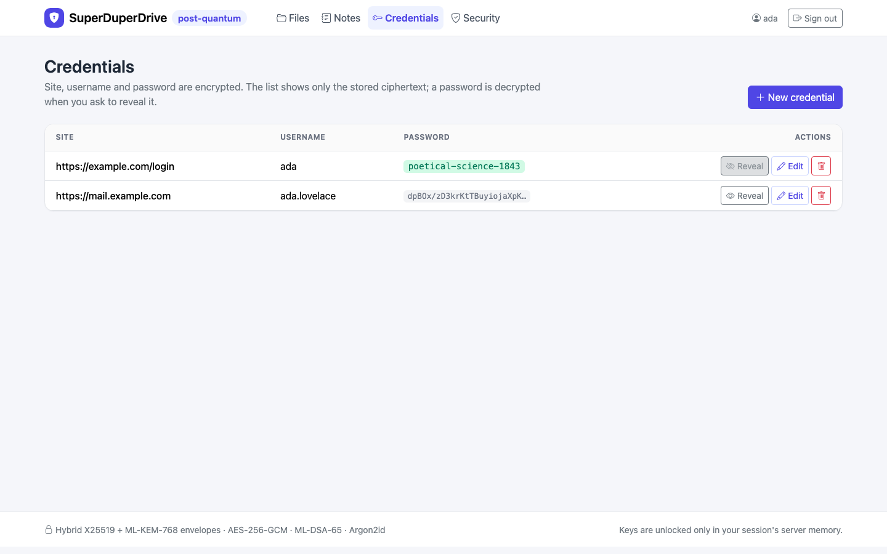 | 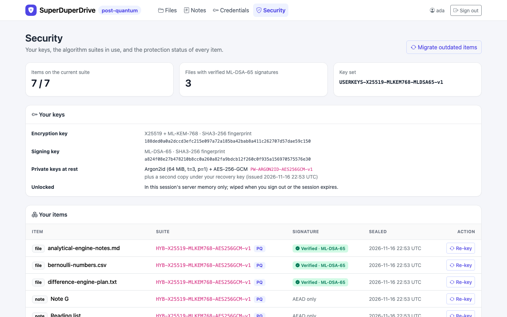 |
| **Reveal** decrypts one password on demand | **Security.** Keys, suites, per-item status |
| 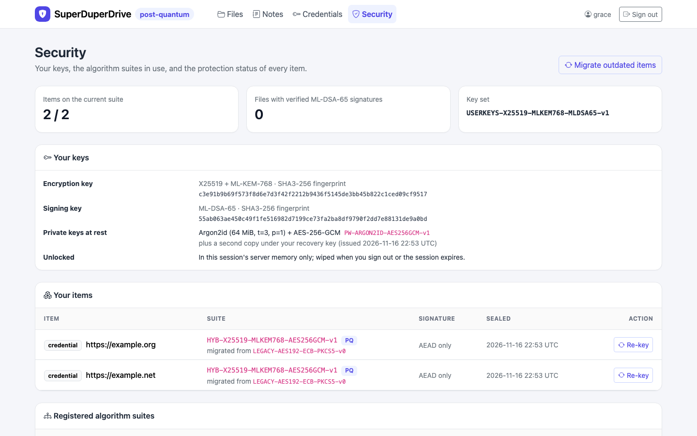 | 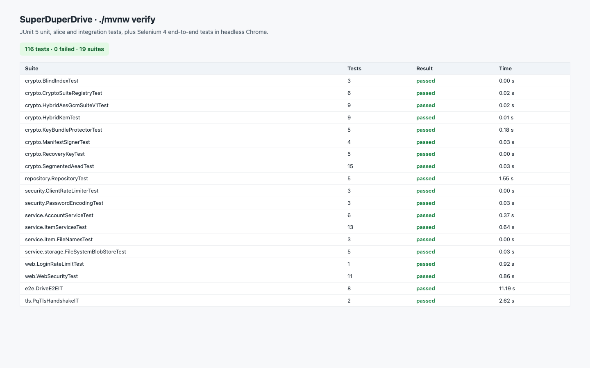 |
| **Migration.** A 2020 account after its first login | **Tests.** `./mvnw verify` |

All screenshots use fictional data (`ada`, `grace`, `example.com`).

## Quickstart

Requirements: JDK 21 or newer. Chrome is needed only for the end-to-end tests.

```bash
./mvnw spring-boot:run
```

Open <http://localhost:8085>, create an account and save the recovery key it shows. Data is
kept in `./data` (H2 database and encrypted blobs).

To see the legacy migration, start with the `demo` profile. It seeds an account exactly as the
2020 version stored it (PBKDF2-SHA1 hash, AES/ECB credentials, no key pairs):

```bash
./mvnw spring-boot:run -Dspring-boot.run.profiles=demo
# sign in as grace / grace-hopper-1906, then open Security
```

### Docker

```bash
docker build -t superduperdrive .
docker run --rm -p 8085:8085 -v sdd-data:/app/data superduperdrive
```

The image is multi-stage and layered, and runs as an unprivileged user (uid 10001).

### Profiles

| Profile | What it does |
|---|---|
| *(default)* | H2 file database in `./data`, HTTP on port 8085 |
| `postgres` | PostgreSQL from `SDD_DB_URL`, `SDD_DB_USER` and `SDD_DB_PASSWORD` |
| `pqtls` | HTTPS on port 8443, TLS 1.3 via Bouncy Castle JSSE, `X25519MLKEM768` first, with an in-memory self-signed certificate for `localhost` |
| `demo` | Seeds the legacy 2020-style account `grace` |

```bash
SDD_DB_URL=jdbc:postgresql://localhost:5432/superduperdrive SDD_DB_USER=sdd SDD_DB_PASSWORD=change-me \
  ./mvnw spring-boot:run -Dspring-boot.run.profiles=postgres

./mvnw spring-boot:run -Dspring-boot.run.profiles=pqtls   # https://localhost:8443
```

## Architecture

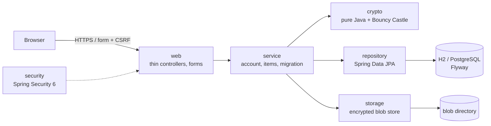

| Package | Responsibility |
|---|---|
| `web` | Thin MVC controllers, validated form objects, exception mapping |
| `security` | Login flow that unlocks the keyring, lockout, rate limiting, session keyring holder, legacy password encoder |
| `service.account` | Signup, unlock, recovery, lockout state |
| `service.item` | Notes, credentials, files, migration and re-keying, Security overview |
| `service.storage` | Atomic, transactional, sharded blob store with an orphan sweeper |
| `crypto` | Hybrid KEM, suites and registry, STREAM AEAD, ML-DSA manifests, Argon2id key wrapping, recovery keys. No Spring dependencies. |
| `domain`, `repository` | JPA entities with optimistic locking and auditing; derived-query repositories only |
| `config` | Security headers and filter chain, DRBG, suites, PQ-TLS |

The application has no hand-written SQL or JPQL. Every query is a Spring Data derived query,
and invariants such as unique usernames, unique file names per user and well-formed
credentials are enforced by database constraints in the Flyway baseline.

## Cryptography at a glance

| Layer | Choice |
|---|---|
| Item key encapsulation | X25519 + ML-KEM-768 (FIPS 203), HKDF-SHA-512 combiner binding both ciphertexts and public keys |
| Item encryption | AES-256-GCM with associated data `(kind, item id, owner id, suite, version)` |
| File content | STREAM over AES-256-GCM, 64 KiB segments |
| File authenticity | ML-DSA-65 (FIPS 204) over an RFC 8785 canonical JSON manifest with SHA3-256 |
| Private keys at rest | Argon2id (64 MiB, t=3) + AES-256-GCM, plus a recovery-key copy |
| Password hashing | Argon2id via `DelegatingPasswordEncoder`; legacy PBKDF2-SHA1 upgraded on login |
| Unique file names | HMAC-SHA3-256 blind index |
| Randomness | `DRBG` (Hash_DRBG, SHA-256, 256-bit) |
| Transport (optional) | TLS 1.3 with `X25519MLKEM768` via BCJSSE |

The full design is in **[docs/CRYPTO.md](docs/CRYPTO.md)**: threat model, key hierarchy diagrams,
byte formats, the agility and migration model, and what is **not** protected.

## Security notes

- This is **server-side** encryption with per-user keys, not end-to-end encryption. The server
  sees your password at sign-in and holds your unlocked keys in memory while you are signed in.
  It protects against database, backup and storage theft, and against tampering, not against a
  compromised running server.
- File sizes, item counts, timestamps, usernames and display names are not encrypted.
- Lose both your password and your recovery key and the data is unrecoverable, by design.
- The default profile serves plain HTTP for local use. Use `pqtls` or a TLS-terminating proxy
  anywhere else.
- Not independently audited. See [SECURITY.md](SECURITY.md) to report issues.

## Testing

```bash
./mvnw verify
```

`verify` runs 116 tests: 106 unit, slice and MockMvc tests (surefire) and 10 integration tests
(failsafe). The opt-in screenshot tour is skipped by default.

- **Crypto unit tests.** Hybrid KEM round trip, wrong recipient, context binding, implicit
  rejection, small-order points; envelope tampering and transplanting; STREAM boundaries,
  truncation, reordering, extension and bit flips; key wrapping with a wrong password, user or
  downgraded Argon2 parameters; recovery-key checksums; ML-DSA manifests and canonical JSON;
  the suite registry; and known-answer decryption of real 2020 AES/ECB data.
- **Persistence and services.** `@DataJpaTest` against the Flyway schema, owner isolation, tamper
  detection, legacy and retired-suite migration, re-keying, and recovery.
- **Web security.** Security headers, CSRF, lockout, rate limiting, a legacy login upgrade, and
  download headers.
- **End to end.** `DriveE2EIT` drives the whole journey in headless Chrome with Selenium 4.
  `PqTlsHandshakeIT` proves an `X25519MLKEM768`-only client connects and a classical-only client
  is refused.

The screenshots are produced by an opt-in tour against a running instance:

```bash
./mvnw spring-boot:run -Dspring-boot.run.profiles=demo
./mvnw test-compile failsafe:integration-test -Dit.test=ScreenshotTourIT \
  -Dsdd.screenshots.baseUrl=http://localhost:8085
```

## Project history

Started as a Udacity Java Web Developer Nanodegree project (2020); rebuilt in 2026.

The 2020 version (Spring Boot 2.2, MyBatis, AES/ECB) is preserved in the git history. Its
password-hash and credential-encryption formats remain readable through decrypt-only legacy
suites, and accounts in those formats move to the post-quantum design at their first sign-in.
The `demo` profile seeds one so you can watch it happen. There is no importer for the old
database schema. See the [changelog](CHANGELOG.md).

## License

[MIT](LICENSE) © 2020-2026 Sarath Makkena
