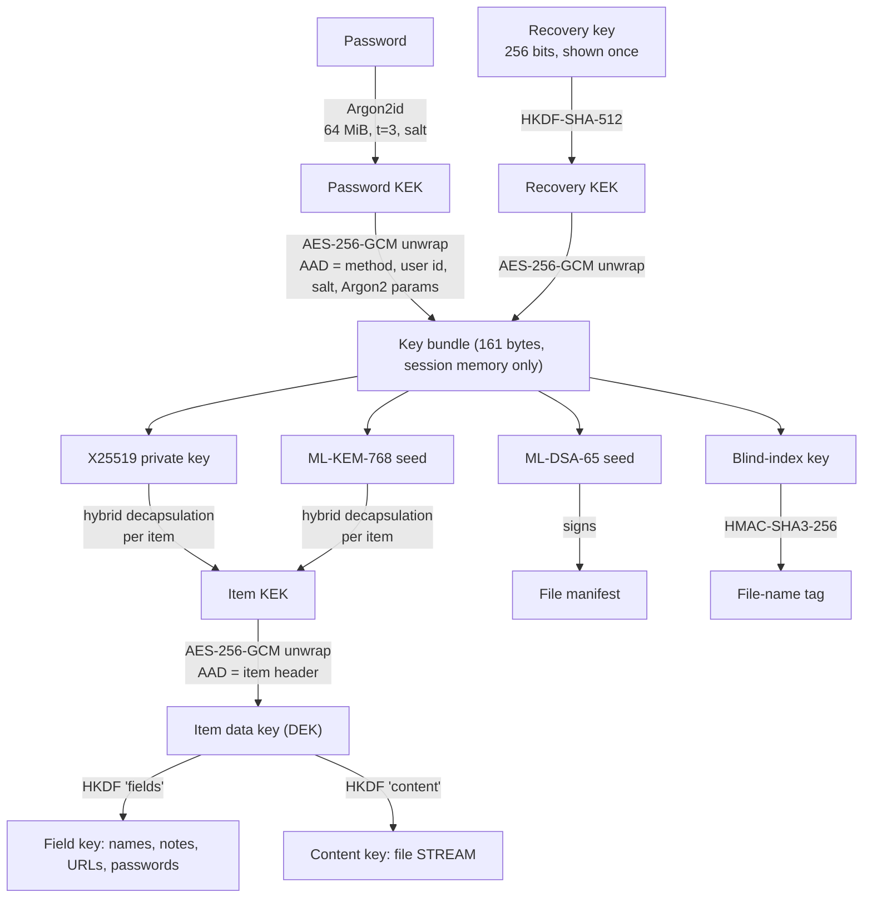
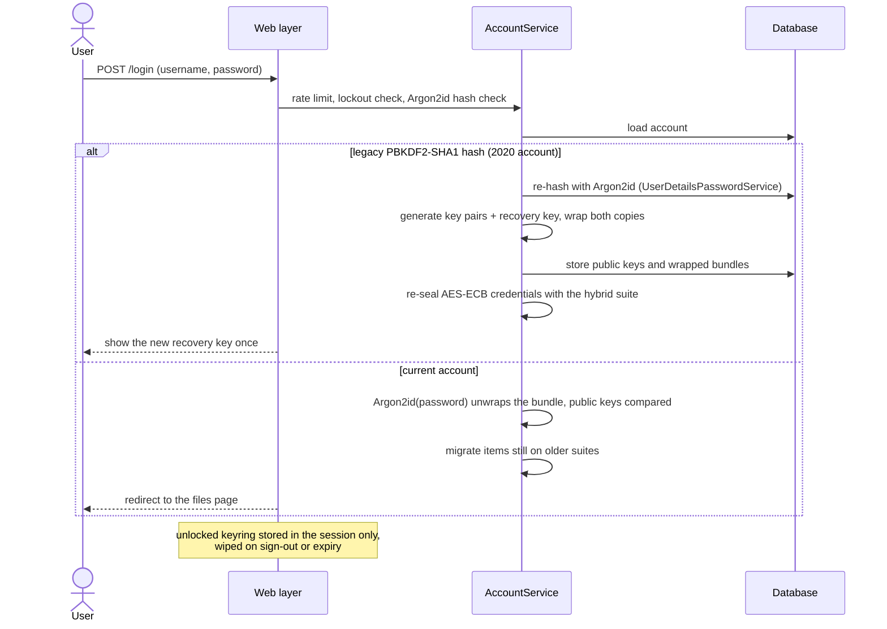

# Cryptography in SuperDuperDrive

This document describes what SuperDuperDrive encrypts, how, against whom, and, just as
importantly, what it does **not** protect. Everything here is implemented with Bouncy Castle
1.87 (`bcprov`, `bcpkix`, `bctls`) and the JDK, using only the NIST-final algorithm names
(ML-KEM, ML-DSA). The code lives under
[`src/main/java/io/github/xlsarath/superduperdrive/crypto`](../src/main/java/io/github/xlsarath/superduperdrive/crypto)
and has no Spring dependencies, so it can be read and tested on its own.

- [Goals and threat model](#goals-and-threat-model)
- [Algorithms](#algorithms)
- [Key hierarchy](#key-hierarchy)
- [Hybrid KEM combiner](#hybrid-kem-combiner)
- [Item envelopes](#item-envelopes)
- [File content: segmented streaming AEAD](#file-content-segmented-streaming-aead)
- [Signatures and the signed manifest](#signatures-and-the-signed-manifest)
- [Accounts, passwords and the recovery key](#accounts-passwords-and-the-recovery-key)
- [Crypto agility and migration](#crypto-agility-and-migration)
- [Post-quantum TLS (optional)](#post-quantum-tls-optional)
- [Implementation hygiene](#implementation-hygiene)
- [What is NOT protected](#what-is-not-protected)

## Goals and threat model

SuperDuperDrive is a server-rendered web application. The server encrypts and decrypts on the
user's behalf, so this is **encryption at rest with per-user keys, not end-to-end encryption**.

| Adversary | Protected? | How |
|---|---|---|
| Steals a database dump, a backup or the blob directory | **Yes**: no content, file names, URLs, usernames or passwords of stored items | Everything user-supplied is sealed under per-item keys; those keys are reachable only through the user's private keys, which are wrapped under Argon2id(password) or the recovery key |
| Records ciphertext today and owns a cryptographically relevant quantum computer later ("harvest now, decrypt later") | **Yes** for stored data; **yes** for traffic with the `pqtls` profile | Hybrid X25519 + ML-KEM-768 envelopes; X25519MLKEM768 TLS key exchange |
| Can modify the database or blob store (but not the running server) | **Detected**: tampering, swapping items between users, kinds or ids, swapping public keys, forged signatures | AES-GCM with item-binding associated data, ML-DSA-65 signatures over a manifest, public-key consistency check at unlock |
| Guesses passwords online | **Slowed** | Per-account lockout (5 failures for 15 minutes) and per-client sliding-window rate limit |
| Guesses passwords offline from a stolen database | **Made expensive** | Argon2id for password hashes (19 MiB, t=2) and for key wrapping (64 MiB, t=3) |
| Controls the running server, or reads its memory while users are signed in | **No** | See [What is NOT protected](#what-is-not-protected) |

## Algorithms

| Purpose | Algorithm | Standard | Parameters |
|---|---|---|---|
| Post-quantum key encapsulation | ML-KEM-768 | FIPS 203 | 1184-byte public key, 1088-byte ciphertext, private key stored as 64-byte seed |
| Classical key agreement (hybrid half) | X25519 | RFC 7748 | Ephemeral-static; all-zero shared secrets rejected |
| KEM combiner and key derivation | HKDF-SHA-512 | RFC 5869 | See [combiner](#hybrid-kem-combiner) |
| Content and key-wrap encryption | AES-256-GCM | SP 800-38D | 96-bit random nonces (wrap, fields); 96-bit derived nonces (streams); 128-bit tags |
| Streaming file encryption | STREAM construction over AES-256-GCM | Hoang, Reyhanitabar, Rogaway, Vizár (2015) | 64 KiB segments |
| Signatures | ML-DSA-65 | FIPS 204 | Pure mode, hedged, context string `SDD-FILE-MANIFEST-v1`; 3309-byte signatures |
| Content digests, fingerprints | SHA3-256 | FIPS 202 | |
| Blind index (unique file names) | HMAC-SHA3-256 | RFC 2104 | Per-user 256-bit key |
| Password-based key wrapping | Argon2id | RFC 9106 | m = 64 MiB, t = 3, p = 1 (RFC 9106 "second recommended option"); 32-byte salt |
| Password hashing | Argon2id via Spring Security `Argon2PasswordEncoder` | RFC 9106 | m = 19 MiB, t = 2, p = 1 (OWASP minimum), behind `DelegatingPasswordEncoder` |
| Random numbers | `DRBG` (Hash_DRBG, SHA-256, 256-bit strength) | SP 800-90A | One shared instance, seeded by the OS |
| Legacy, decrypt-only | AES-192/ECB/PKCS5Padding; PBKDF2-HMAC-SHA1 (5000 iterations) | | Only to read and upgrade data written by the 2020 version |

## Key hierarchy



- **User key bundle.** At signup (or at the first login of an account from 2020) the server
  generates an X25519 key pair, an ML-KEM-768 key pair, an ML-DSA-65 key pair and a blind-index
  key. The private parts are serialised as a 161-byte bundle:
  `0x01 ‖ X25519 private (32) ‖ ML-KEM seed d‖z (64) ‖ ML-DSA seed ξ (32) ‖ index key (32)`.
  Storing seeds keeps the bundle small and lets the full private keys be re-derived exactly.
- **Two wrapped copies** are stored: one under Argon2id(password), one under the recovery key.
  The AES-GCM associated data binds the wrap method, the account id, the salt and the Argon2
  parameters, so a bundle cannot be moved to another account and its cost parameters cannot be
  silently weakened.
- **Public keys** are stored in clear. At every unlock the public keys derived from the unwrapped
  bundle are compared with the stored ones; a mismatch (for example a database attacker
  substituting their own public keys) aborts the login.
- **Unlocked keys** live only in the HTTP session, inside a holder that is deliberately not
  `Serializable` (so it is never persisted or replicated) and that wipes the key material when the
  session ends, on sign-out, expiry or invalidation.

## Hybrid KEM combiner

Every item is encrypted to its owner's hybrid public key. Encapsulation runs ML-KEM-768
encapsulation and an ephemeral X25519 key agreement, then combines both secrets:

```
ss_M, ct_M = ML-KEM-768.Encaps(pk_M)
e          = fresh X25519 key pair;  ct_X = e.public;  ss_X = X25519(e.private, pk_X)
KEK = HKDF-SHA-512(
        salt = "SuperDuperDrive/HybridKEM/X25519-MLKEM768/v1",
        ikm  = ss_M ‖ ss_X,
        info = LP(ct_M) ‖ LP(ct_X) ‖ LP(pk_M) ‖ LP(pk_X) ‖ LP(context),
        L    = 32)
hybrid ciphertext = ct_X (32) ‖ ct_M (1088)            -- 1120 bytes
```

`LP(x)` is a 4-byte big-endian length prefix followed by `x`, so the encoding is injective. As in
X-Wing (draft-connolly-cfrg-xwing-kem), the classical ciphertext and public key are bound into
the derivation, so the KEK stays secure as long as **either** ML-KEM-768 or X25519 is unbroken.
Unlike X-Wing, the ML-KEM ciphertext and public key are hashed in too: that costs about 2 KB of
extra hashing and does not depend on ML-KEM's ciphertext-collision resistance. The `context` is
the item header described below, which ties the KEK to one item. A tampered ML-KEM ciphertext
does not raise an error: ML-KEM's implicit rejection yields a pseudorandom secret and the
subsequent AES-GCM unwrap fails. A small-order X25519 share is rejected outright.

## Item envelopes

Notes, credentials and files are all sealed the same way (`HybridAesGcmSuiteV1`):

```
header = LP("SDD/ITEM") ‖ LP(kind) ‖ LP(itemId) ‖ LP(ownerId) ‖ LP(suiteId) ‖ LP(envelopeVersion)
DEK    = 32 random bytes                                  (fresh on every save and re-key)
KEK    = hybrid encapsulation to the owner's public key, context = header
wrap   = AES-256-GCM(KEK, nonce, DEK, aad = header)      (stored with the KEM ciphertext)
fieldKey   = HKDF-SHA-512(ikm = DEK, salt = "SDD/DEK/v1", info = "fields")
contentKey = HKDF-SHA-512(ikm = DEK, salt = "SDD/DEK/v1", info = "content")
field ciphertext = nonce (12) ‖ AES-256-GCM(fieldKey, nonce, value, aad = header ‖ LP(fieldName))
```

Because the header is the associated data everywhere, a ciphertext copied to another item, owner,
item kind or suite fails authentication, and so does a field moved to another column (for
example a note title pasted into the body). Every edit draws a new DEK and a new encapsulation.

Stored per item: `suite_id`, `envelope_version`, `kem_ciphertext` (1120 B), `wrap_nonce`,
`wrapped_dek` (48 B), `sealed_at`, `migrated_from_suite`, and the field ciphertexts. File names
must be unique per user. The database enforces this with a unique constraint on
`(owner_id, name_tag)`, where `name_tag = HMAC-SHA3-256(indexKey, LP("SDD/BLIND-INDEX/v1") ‖ LP("file-name") ‖ LP(lowercase(NFC(name))))`.
The server can therefore check for duplicates without decrypting or storing the name in clear.

## File content: segmented streaming AEAD

Files are never held in memory as a whole. Content is encrypted with the STREAM construction
over AES-256-GCM, which provides online authenticated encryption and resists reordering,
truncation and extension:

```
blob    = header (16) ‖ segment_0 ‖ … ‖ segment_n
header  = "SDDS" ‖ 0x01 ‖ segmentSize (uint32) ‖ noncePrefix (7 random bytes)
nonce_i = noncePrefix ‖ uint32(i) ‖ lastFlag (0x00, or 0x01 on the final segment)
segment_i = AES-256-GCM(contentKey, nonce_i, plaintext_i, aad = item header ‖ LP("content") ‖ stream header)
```

Each segment holds up to 64 KiB of plaintext plus a 16-byte tag. An empty file is a single empty
final segment. Blobs are written to a `.pending` directory, `fsync`ed, then atomically moved
into place and published only when the database transaction commits. Blobs left orphaned by a
crash are swept after a grace period.

**Downloads are verified before any byte is released.** The server first decrypts the whole
stream into a SHA3-256 digest, compares it with the digest in the signed manifest and verifies
the ML-DSA-65 signature. Only then does it decrypt a second time while streaming to the client.
Tampered content returns an error and never a partial file.

## Signatures and the signed manifest

At upload the server builds a manifest and signs it with the uploader's ML-DSA-65 key:

```json
{"algorithm":"ML-DSA-65","contentType":"text/csv","context":"SDD-FILE-MANIFEST-v1",
 "fileId":"…","fileName":"bernoulli-numbers.csv","format":"sdd-manifest/1","ownerId":"…",
 "sha3_256":"…","signerKey":"<SHA3-256 fingerprint of the ML-DSA public key>","size":31,
 "uploadedAt":"2026-11-16T22:44:51.123Z"}
```

The signed message is the RFC 8785 (JCS) canonical form (sorted keys, no whitespace, integer
values only), so any verifier can reproduce it byte for byte. The FIPS 204 context string keeps
a manifest signature from being valid for any other purpose. The Files page shows
**Verified · ML-DSA-65** only for files whose signature verifies against the public key held in the
current session, and **Manifest** exports the statement, signature and public key as JSON for
independent verification.

## Accounts, passwords and the recovery key



- **Password hashes** use `DelegatingPasswordEncoder` with Argon2id as the default. Hashes from
  2020 (`{legacy-pbkdf2-sha1}salt$hash`, verify-only) still work once and are replaced by
  Argon2id at the next successful login.
- **Login hardening.** CSRF tokens on every form, session-id rotation at login (fixation
  protection), `SameSite=Strict` and `HttpOnly` session cookie, account lockout after 5 failures,
  a per-client sliding-window limit on `/login` and `/recover`, and generic error messages that
  do not reveal whether an account exists.
- **Recovery key.** 256 random bits plus a 24-bit SHA3 checksum, shown once as 56 Base32
  characters in 14 groups. It is the only way back to the data after a forgotten password.
  Using it re-wraps the bundle under the new password, issues a new recovery key and retires the
  old one. Wrong recovery keys count towards the lockout.

## Crypto agility and migration

Every sealed item records the suite id and envelope version that produced it. The
`CryptoSuiteRegistry` resolves suites by id, refuses unknown ids and decrypt-only suites for new
writes, and names exactly one current suite.

| Suite id | Status | Quantum-safe |
|---|---|---|
| `HYB-X25519-MLKEM768-AES256GCM-v1` | current | yes (hybrid) |
| `LEGACY-AES192-ECB-PKCS5-v0` | decrypt only | no |

Adding a suite means implementing `EnvelopeSuite`, registering it and switching
`sdd.crypto.current-suite`. At the next login, `CryptoMigrationService` re-seals every item
that is not on the current suite and records where it came from. The **Security** page shows
each item's suite and signature status, a **Re-key** action (new DEK and encapsulation for one
item; files are re-encrypted into a new blob) and **Migrate outdated items**. The tests prove
the path both from the real legacy ECB data and from a stand-in retired suite.

The 2020 version encrypted credential passwords with AES/ECB. Its "key" was the 24 ASCII
bytes of a Base64 string stored in the same row, which made it AES-192 in practice. That
suite exists only so this data can be read once and upgraded. Its columns are cleared after
migration.

## Post-quantum TLS (optional)

With the `pqtls` profile the embedded Tomcat serves HTTPS through Bouncy Castle JSSE, using TLS 1.3
only, with named groups `X25519MLKEM768, x25519, secp256r1`. Current Chrome, Edge and Firefox
releases negotiate the hybrid group. A self-signed ECDSA P-256 certificate for `localhost` is
generated in memory at startup. Authentication stays classical on purpose: browsers do not
accept ML-DSA certificates yet, and unlike confidentiality, authentication cannot be broken
after the fact. `PqTlsHandshakeIT` starts the server with only the hybrid group enabled. It
proves that a client offering only `X25519MLKEM768` completes the handshake and that a
classical-only client is refused.

## Implementation hygiene

- Only NIST-final names and parameter sets (ML-KEM-768, ML-DSA-65). Nothing uses pre-standard
  Kyber or Dilithium variants.
- One `DRBG` `SecureRandom` instance, created explicitly with a 256-bit strength request.
- Secret comparisons use constant-time equality (`Bytes.constantTimeEquals`, Bouncy Castle
  `Arrays.constantTimeAreEqual`).
- Keys, DEKs, seeds, shared secrets and intermediate KEKs are `byte[]` and are zeroed in
  `finally` blocks or `close()` (`try-with-resources` for every cipher and key object).
- No ECB mode anywhere except the decrypt-only legacy suite. No unauthenticated encryption.
- Nonces are random 96-bit values for single-shot GCM. Each GCM key encrypts at most a few
  fields or exactly one stream, far below the 2³² random-nonce limit.
- Every length-variable input to a KDF or MAC is length-prefixed.
- Secrets, passwords, recovery keys and plaintext never appear in logs. Logs carry ids, counts,
  suite ids and outcomes.

## What is NOT protected

Being explicit about the limits matters more than the list of algorithms.

1. **A compromised running server.** The server receives each password at login and holds
   unlocked private keys in memory for the length of the session. An attacker who controls the
   process, its memory, its logs configuration or its code can read the data of every user who
   signs in. Only client-side (browser) cryptography would change this.
2. **Metadata.** Usernames, first and last names, account timestamps, the number of items,
   item ids, creation and update times and file sizes (stored in clear, and visible from blob
   sizes anyway) are not hidden. File names, content types, note text,
   credential URLs, usernames and passwords are encrypted.
3. **Rollback within an item.** A database attacker can restore an older, validly sealed
   version of the same item (with its old blob). The binding covers item id, owner, kind and
   suite, but not a version counter. Deleting items is also undetectable.
4. **Weak passwords.** A stolen database allows offline guessing against Argon2id. The cost is
   high but finite. A strong password or passphrase is still required.
5. **Lost credentials.** Without the password and the recovery key the data is gone. There is no
   back door.
6. **Memory hygiene in the JVM.** Passwords arrive as immutable `String`s from the servlet
   container, and the garbage collector may copy arrays before they are wiped. Wiping is
   best-effort, as in any managed runtime.
7. **Side channels.** Bouncy Castle's implementations aim to be constant-time, but the JIT and the
   platform give no hard guarantees. The deployment is assumed not to share CPUs with
   adversaries.
8. **Signatures prove the uploader's key signed it, not who the uploader is.** Keys are generated by
   the server and there is no PKI or key transparency. Signatures detect tampering with stored
   data; they do not authenticate users to third parties.
9. **Transport security without the `pqtls` profile or a TLS-terminating proxy.** The default
   profile listens on plain HTTP for local development.
10. **Availability.** Nothing here prevents deletion, corruption or denial of service.
